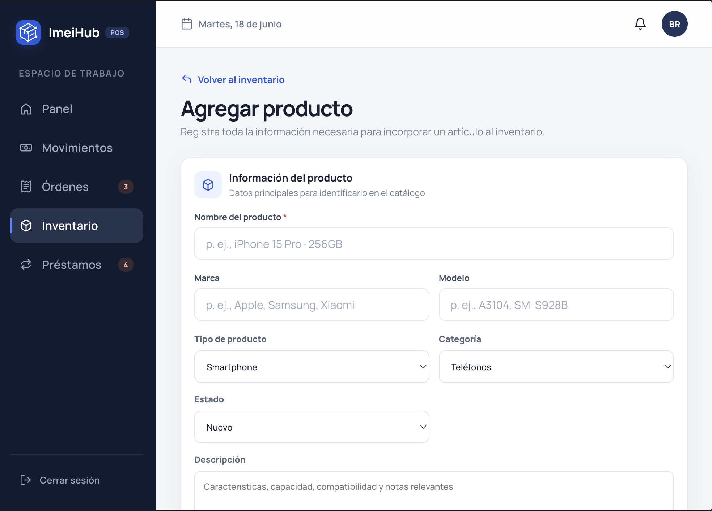
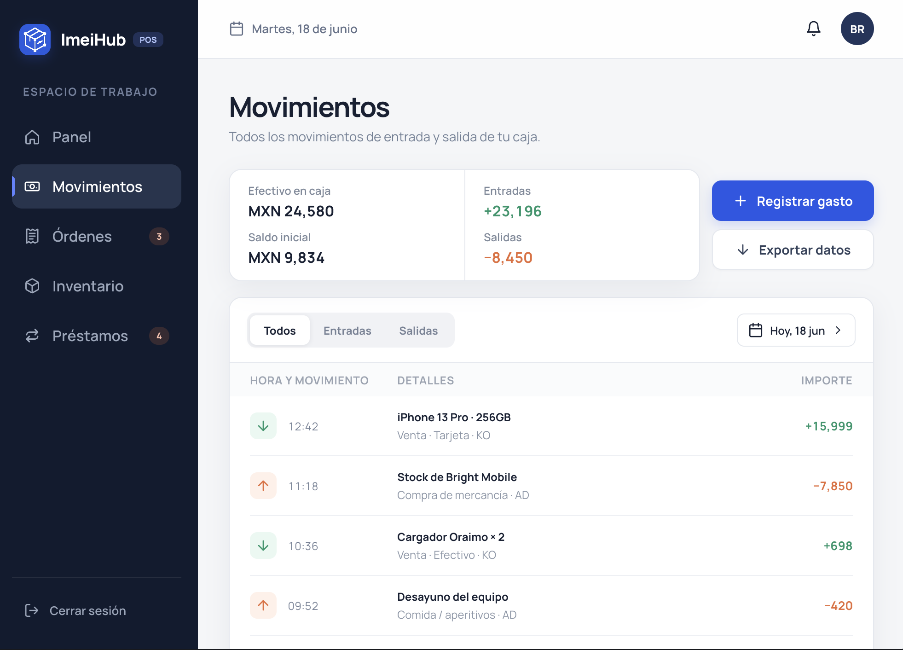
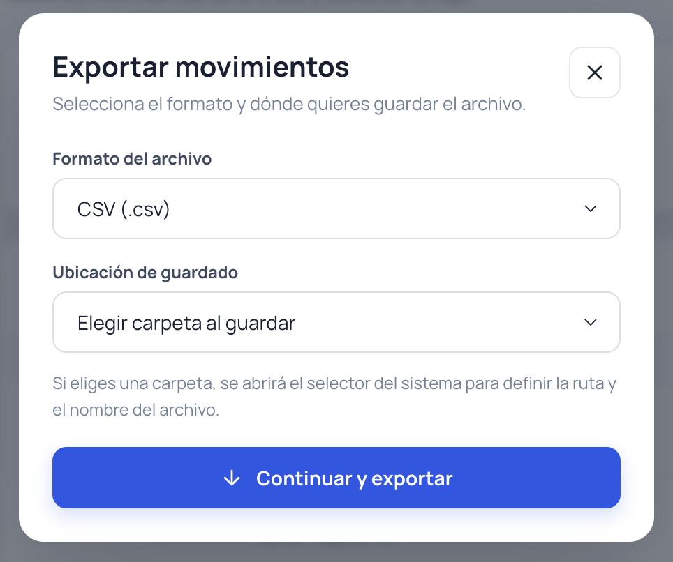
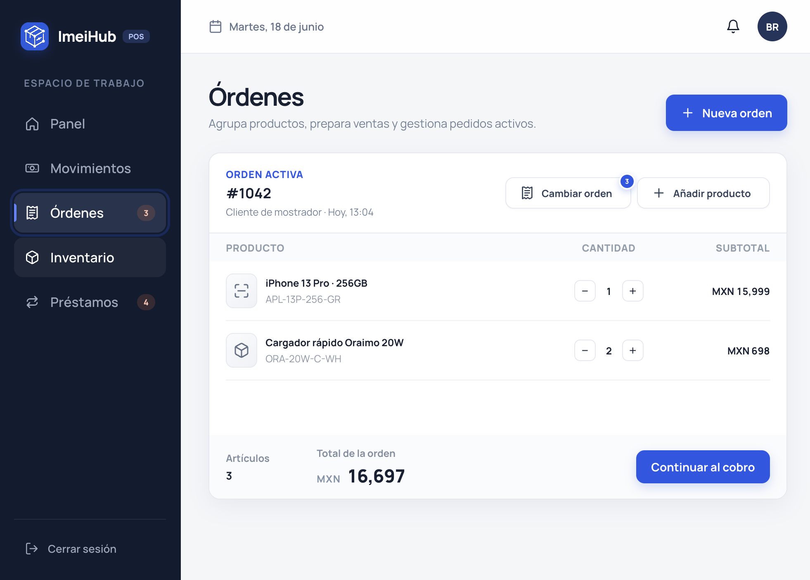
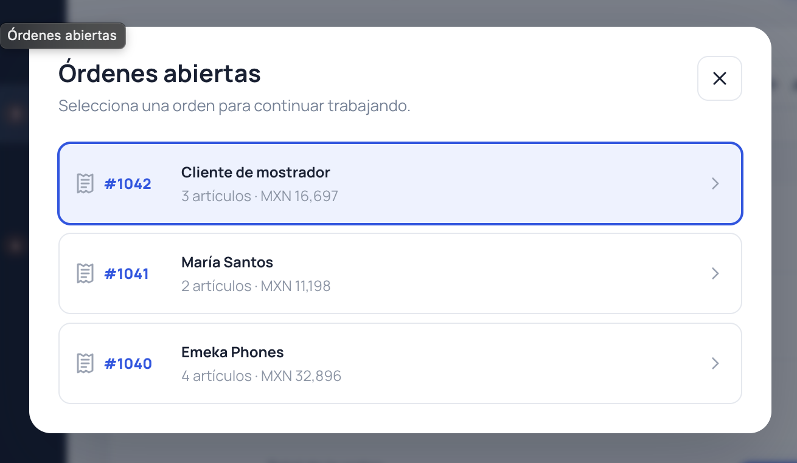
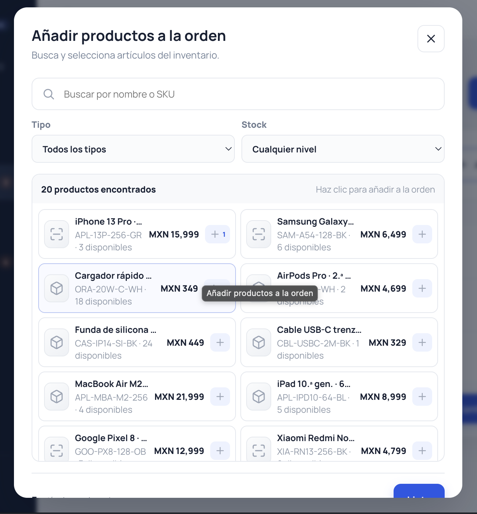
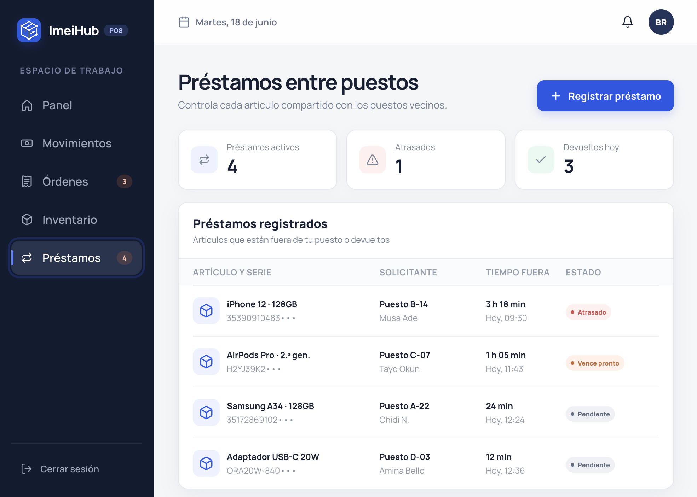

# ImeiHub · Sistema de Punto de Venta y Trazabilidad por IMEI
**Integrantes del equipo**:
Brandon Michelle Pérez Saldaña
Yair Emmanuel Arias Madera

<p align="center">
  
</p>

<p align="center">
  
  
  
  
</p>

> **ImeiHub** es un sistema integral de punto de venta (POS), control de inventario seriado, trazabilidad por código IMEI, flujo de préstamos entre puestos vecinos y conciliación de caja en tiempo real, concebido para el comercio de telefonía móvil, computación y electrónica en plazas comerciales y puestos de mercado.

---

## 📋 Tabla de Contenidos

1. [¿Qué es ImeiHub y cuál es su funcionalidad?](#-qué-es-imeihub-y-cuál-es-su-funcionalidad)
2. [¿Qué problema resuelve y cómo lo resuelve?](#-qué-problema-resuelve-y-cómo-lo-resuelve)
3. [Explicación detallada de todas las vistas, modales y funcionalidades](#-explicación-detallada-de-todas-las-vistas-modales-y-funcionalidades)
   - [3.1. Acceso y Autenticación (`/login` y `/register`)](#31-módulo-de-autenticación-y-control-de-acceso)
   - [3.2. Panel Principal / Dashboard (`/dashboard`)](#32-vista-de-panel-principal--dashboard-dashboard)
   - [3.3. Inventario y Catálogo Seriado (`/inventory`)](#33-vista-de-inventario-y-catálogo-inventory)
   - [3.4. Movimientos y Flujos de Caja (`/cash`)](#34-vista-de-movimientos-de-caja-cash)
   - [3.5. Cierre de Turno y Arqueo Físico (`/close`)](#35-vista-de-cierre-de-caja-y-arqueo-close)
   - [3.6. Órdenes de Venta y Checkout (`/orders`)](#36-vista-de-órdenes-de-venta-orders)
   - [3.7. Préstamos entre Puestos Vecinos (`/loans`)](#37-vista-de-préstamos-entre-puestos-loans)
   - [3.8. Módulos Flotantes y Overlays Globales](#38-overlays-y-módulos-flotantes-globales)
   - [3.9. Shell, Navegación y Experiencia de Usuario](#39-shell-de-aplicación-navegación-y-notificaciones)
4. [Matriz Resumen de Rutas y Capacidades](#-matriz-resumen-de-rutas-y-capacidades)
5. [Arquitectura Técnica y Estado en Memoria](#-arquitectura-técnica-y-estado-en-memoria)
6. [Estructura del Proyecto](#-estructura-del-proyecto)
7. [Guía de Instalación y Ejecución](#-guía-de-instalación-y-ejecución)
8. [Documentación Formal en Word (.docx)](#-documentación-formal-en-word-docx)

---

## 📱 ¿Qué es ImeiHub y cuál es su funcionalidad?

**ImeiHub** es una Single Page Application (SPA) construida con **Angular 19** y **TypeScript**, optimizada para dispositivos táctiles, computadoras de mostrador y tablets. Está diseñada para digitalizar la operación completa de comercios de telefonía móvil y reparación técnica.

A diferencia de los sistemas de punto de venta convencionales (enfocados en productos de consumo masivo con código de barras universal), el comercio de teléfonos y dispositivos inteligentes requiere:
- **Identificación legal unívoca por equipo:** Control del código IMEI (15 dígitos) o número de serie de cada teléfono individual.
- **Doble precio de venta:** Conocimiento instantáneo del *Precio Ideal* de lista frente al *Precio Mínimo de Negociación* permitido en mostrador.
- **Gestión de préstamos informales:** Control estricto de los equipos que se prestan temporalmente a locales vecinos de la plaza para mostrárselos a clientes ("pasa-manos").
- **Conciliación continua de efectivo:** Registro clasificado de gastos operativos menores ("gastos hormiga") y arqueo físico contra el balance teórico.

---

## 🎯 ¿Qué problema resuelve y cómo lo resuelve?

### 1. Descontrol en la Identificación Unívoca (IMEI vs Código de Barras genérico)
* **El Problema:** Dos cajas de *iPhone 13 Pro 256GB* son artículos idénticos en catálogo, pero legal y técnicamente son dispositivos distintos con historiales, garantías y números de serie únicos. Si un sistema POS los trata como simples códigos de barra repetidos, se entregan IMEIs equivocados a los clientes, perdiendo la garantía con distribuidores y arriesgándose a comercializar equipos con reporte de extravío.
* **Cómo lo resuelve ImeiHub:** Cada artículo en inventario registra su **IMEI o serie individual**, código de barras específico, estado físico (*Nuevo, Seminuevo, Reacondicionado*) y desglose por variantes de color con stock exacto.

### 2. Pérdidas Crónicas por Préstamos Informales ("Pasa-manos" en plazas de tecnología)
* **El Problema:** En plazas comerciales, cuando un cliente busca un color o modelo agotado en un puesto, el dependiente pide prestado el equipo al local vecino por unos minutos. Con frecuencia, si el cliente no compra, el teléfono se queda olvidado en el otro local, se mezcla con mercancía ajena o se extravía, costando decenas de miles de pesos en pérdidas y fricciones entre comerciantes.
* **Cómo lo resuelve ImeiHub:** Cuenta con un **Módulo de Préstamos entre Puestos** donde se asienta qué artículo salió, a qué número de puesto fue (ej. *Puesto B-14*), quién fue el responsable de llevárselo (*ej. Carlos Mendoza*), hora de salida y cronómetro en tiempo real con alertas visuales por retraso. El retorno se confirma formalmente reingresando la unidad a vitrina.

### 3. Descuadre Permanente de Caja Chica y Gastos Operativos
* **El Problema:** Durante la jornada se pagan comidas, pasajes, envíos y refacciones a proveedores que pasan por los pasillos. Sin un registro ágil e inmediato, al final del día la caja nunca cuadra y el comerciante no sabe si faltó dinero por cobros mal hechos, robo hormiga o gastos no apuntados.
* **Cómo lo resuelve ImeiHub:** Flujo contable reactivo en tiempo real (`CashService`) con registro en 2 toques de cualquier gasto clasificado (*Mercancía, Comida, Transporte, Otros*), cálculo del saldo proyectado tras el gasto y un módulo de **Cierre de Caja** que compara el conteo físico en billetes contra el cálculo del sistema, indicando con precisión si el corte es *Exacto*, *Sobrante* o *Faltante*.

### 4. Rigidez en Precios y Pérdida de Ventas en Mostrador
* **El Problema:** En la venta de tecnología usada o seminueva el regateo es habitual. Si el dependiente no sabe hasta cuánto puede bajar el precio, pierde la venta o tiene que llamar al propietario para pedir autorización.
* **Cómo lo resuelve ImeiHub:** Cada producto muestra de forma transparente el **Precio Ideal** y el **Precio Mínimo de Negociación** autorizado, otorgando autonomía a los vendedores para cerrar tratos rentables sin consultar a terceros.

### 5. Complejidad en Medios de Pago y Facturación
* **El Problema:** Clientes que pagan parte en efectivo, parte en transferencia bancaria (SPEI/BBVA) o con terminal física (Mercado Pago/Clip), sumado a quienes requieren factura con CFDI.
* **Cómo lo resuelve ImeiHub:** Pasarela integrada de checkout con cálculo automático de cambio en efectivo, datos bancarios receptores (CLABE y concepto), captura de folio de voucher con tarjeta, y opción de facturación electrónica con validación estricta de RFC y Razón Social, descontando el inventario automáticamente tras confirmar la compra.

---

## 🖥️ Explicación detallada de todas las vistas, modales y funcionalidades

### 3.1. Módulo de Autenticación y Control de Acceso

#### A. Iniciar Sesión (`LoginComponent` · Ruta: `/login`)
Permite a los usuarios acceder al sistema de forma segura.


*Figura 1: Pantalla de inicio de sesión con validación de credenciales, control de visibilidad y acceso rápido.*

* **Formulario Reactivo con Validación:** Validación sintáctica de correo electrónico y contraseña.
* **Componente de Contraseña (`PasswordFieldComponent`):** Toggle visual de ojo para alternar entre texto claro y caracteres ocultos, con tipografía uniforme para evitar distorsiones en el placeholder.
* **Control de Sesión en Memoria:** Autenticación rápida administrada mediante Signals en `AuthService`, asignando token y datos de usuario sin depender de `localStorage`.
* **Guardia de Navegación (`guestGuard`):** Redirige directamente al Dashboard si ya existe una sesión activa para evitar pantallas redundantes.

#### B. Registro de Tienda y Usuario (`RegisterComponent` · Ruta: `/register`)
Permite registrar un nuevo negocio o puesto comercial.


*Figura 2: Registro de nuevo usuario, asignación de tienda y puesto comercial.*

* **Información Integral:** Captura de Nombre completo del titular, Nombre comercial de la tienda (ej. *SmartFix*), Número de puesto físico (ej. *Puesto A-18*) y Correo corporativo.
* **Validación de Seguridad:** Control de longitud mínima de contraseña y comprobación de coincidencia exacta en la confirmación.
* **Ingreso Automático:** Creación de la cuenta en memoria y redirección directa al Panel de Control con bienvenida personalizada.

---

### 3.2. Vista de Panel Principal / Dashboard (`DashboardComponent` · Ruta: `/dashboard`)
Es la pantalla de inicio y centro de mando tras iniciar sesión.


*Figura 3: Panel de control con balance de caja en vivo, ventas y gastos del día, y acciones rápidas táctiles.*

* **Encabezado Personalizado (`PageHeadingComponent`):** Muestra el nombre del encargado, número de puesto y nombre del negocio registrado.
* **Hero Card de Caja (`CashHeroCardComponent`):** Tarjeta destacada con el saldo total de efectivo disponible en caja física, saldo inicial de apertura, indicador de jornada en curso y acceso directo al cierre de caja.
* **Tarjetas Métricas (`MetricCardComponent`):** Dos tarjetas interactivas que reflejan en tiempo real las **Ventas de Hoy** (entradas en verde con monto acumulado) y los **Gastos de Hoy** (salidas en naranja/rojo).
* **Grilla de Acciones Rápidas (`QuickActionsGridComponent`):** Cuadrícula táctil de 6 botones ilustrados para disparar en un solo toque:
  1. *Nueva Venta (Cobro rápido de mostrador).*
  2. *Registrar Gasto (Salida de caja chica).*
  3. *Escanear IMEI / Código de barras.*
  4. *Prestar Artículo (Salida temporal a vecino).*
  5. *Imprimir Etiqueta Térmica.*
  6. *Ver Órdenes de Venta.*
* **Acceso Directo a Cierre de Turno:** Botón de acción prioritaria para concluir la jornada y conciliar efectivo.

---

### 3.3. Vista de Inventario y Catálogo (`InventoryComponent` · Ruta: `/inventory`)
Administra todas las existencias de dispositivos, accesorios y refacciones.


*Figura 4: Catálogo general de productos con búsqueda predictiva, filtros por categoría y stock seriado.*

* **Barra de Herramientas Predictiva (`InventoryToolbarComponent`):**
  - Input de búsqueda en tiempo real con dropdown de sugerencias coincidentes mientras se escribe.
  - Botón de escaneo rápido con cámara/lector.
  - Chips de filtrado por categoría (*Todos, Teléfonos, Computadoras, Tablets, Cargadores, Fundas, Audio*).
  - Botón indicador con contador de filtros activos.
* **Tabla de Inventario (`InventoryTableComponent`):**
  - Listado con SKU, nombre comercial, categoría, precio formateado y badge de existencias (*En Stock*, *Stock Bajo* en amarillo, *Agotado* en rojo).
  - Paginación interactiva y selección de producto para abrir su ficha completa.
* **Hoja de Filtros Avanzados (`InventoryFiltersSheetComponent`):**
  - Filtro por variante de color (*Grafito, Titanio, Plata, Azul, etc.*).
  - Rango de precios configurable (Precio mínimo y máximo).
  - Estado de stock (*Cualquiera, En stock, Stock bajo, Agotado*).
  - Ordenamiento (*Nombre A–Z, Menor precio primero, Mayor precio primero*).


*Figura 5: Formulario de alta al catálogo con variantes de color, costos, IMEI y margen de negociación.*

* **Alta de Nuevos Productos (`ProductAddViewComponent`):**
  - Formulario exhaustivo: nombre, marca, modelo, tipo de equipo, categoría, estado (*Nuevo, Seminuevo, Reacondicionado*), ubicación física en vitrina.
  - Validación de costo, precio mínimo y precio de venta (impidiendo fijar precios de venta menores al costo).
  - Generador dinámico de variantes de color con stock individual.
  - Asignación de SKU e IMEI/Serie.
* **Modal de Detalle de Producto (`ProductDetailModalComponent`):**
  - Ficha técnica con comparativa de **Precio Ideal vs Precio Mínimo**.
  - Identificador unívoco: IMEI, número de serie y código de barras.
  - Selector de variantes de color con stock específico por color.
  - Acciones directas: *Imprimir etiqueta de precio*, *Editar datos* y *Eliminar del inventario* con confirmación.
* **Hoja de Edición de Producto (`ProductEditSheetComponent`):**
  - Edición en caliente de nombre, SKU, precio ideal, precio mínimo, costo y existencias totales con impacto reactivo inmediato en todo el sistema.

---

### 3.4. Vista de Movimientos de Caja (`CashFlowComponent` · Ruta: `/cash`)
Libro contable y flujo de caja diario para control y auditoría financiera.


*Figura 6: Registro cronológico de ingresos y salidas con selector de fechas y balance acumulado.*

* **Resumen de Caja Superior:** Muestra de forma simultánea el efectivo actual, fondo inicial, total de entradas (+) y total de salidas (−).
* **Segmentador de Flujos:** Botones para filtrar el registro entre *Todos*, solo *Entradas* (cobros de ventas) o solo *Salidas* (gastos y compras).
* **Selector de Fechas (`DatePickerSheetComponent`):** Hoja modal con calendario mensual interactivo para consultar el libro contable de días anteriores, con estado vacío descriptivo si una fecha no registra movimientos.
* **Libro Cronológico de Movimientos:** Fila detallada por cada operación con indicador visual de flujo (flecha verde hacia abajo para entrada, flecha naranja hacia arriba para salida), hora, concepto, responsable e importe.


*Figura 7: Hoja modal para exportar el historial contable a Excel (.xls), CSV, Texto tabulado (.txt) o JSON.*

* **Exportador de Datos (`ExportMovementsModalComponent`):**
  - Permite descargar el registro contable en vivo en 4 formatos: **Excel (.xls)**, **CSV (.csv)**, **Texto tabulado (.txt)** o **JSON (.json)**.
  - Permite elegir guardado mediante *File System Picker* o descarga automática en el navegador.

---

### 3.5. Vista de Cierre de Caja y Arqueo (`CashCloseComponent` · Ruta: `/close`)
Protocolo de seguridad y conciliación obligatoria al concluir el turno.


*Figura 8: Conciliación de caja, conteo de efectivo físico, cálculo de sobrante/faltante y corte firmado.*

* **Hero de Efectivo Esperado:** Cálculo automático del dinero teórico que debe haber en caja (*Saldo Inicial + Ventas − Gastos*).
* **Tarjetas de Cuadre:** Resumen de ventas totales del turno, gastos totales, fondo de apertura y total de transacciones.
* **Desglose de Productos Vendidos:** Lista con hora, producto, cantidad, método de pago y monto de cada venta del turno.
* **Calculadora de Arqueo Físico:** Campo numérico donde el dependiente introduce el dinero contado físicamente en billetes y monedas.
* **Semáforo y Diagnóstico de Conciliación:**
  - **Exacta (verde):** Coincidencia al 100% entre físico y sistema.
  - **Sobrante (azul):** Hay más dinero físico que el calculado (+).
  - **Faltante (rojo):** Falta dinero físico con respecto al registro (−) y explicación diagnóstica.
* **Descarga de Comprobante Oficial:** Genera y descarga un archivo `.json` con el corte firmado (hora, puesto, encargado, apertura, ventas, gastos, arqueo, diferencia y observaciones).
* **Botón de Finalizar Cierre:** Registra formalmente el corte y reinicia el estado de la caja.

---

### 3.6. Vista de Órdenes de Venta (`OrdersComponent` · Ruta: `/orders`)
Gestión de carritos de compra, cotizaciones y pedidos simultáneos.


*Figura 9: Espacio de trabajo activo con pedidos en mostrador y cálculo de importes.*

* **Espacio de Trabajo Activo (`OrderWorkspaceComponent`):** Muestra los productos añadidos a la orden activa, cliente asignado, subtotales por artículo y total de la venta.


*Figura 10: Modal para crear una nueva orden asignando folio y tipo de cliente (Minorista / Mayorista).*

* **Creación de Nueva Orden (`NewOrderSheetComponent`):** Genera una orden vacía con número correlativo automático (ej. *#1043, #1044*) y clasificación de cliente (*Minorista* para mostrador o *Mayorista* para distribución).


*Figura 11: Selector para alternar entre diferentes órdenes y carritos abiertos en simultáneo.*

* **Bandeja de Órdenes Abiertas (`OpenOrdersSheetComponent`):** Permite cambiar entre varias órdenes en atención simultánea, mostrando cantidad de artículos y monto acumulado en cada una.


*Figura 12: Selector de catálogo interactivo para incorporar artículos y accesorios a la orden activa.*

* **Selector de Artículos (`OrderProductPickerSheetComponent`):** Modal conectado al inventario para agregar teléfonos y accesorios a la orden activa.
* **Modificación de Cantidades en Vivo:** Botones (+) y (−) que actualizan el conteo de piezas e importes en tiempo real.


*Figura 13: Pasarela de cobro multicanal con cálculo de cambio, folio bancario y facturación electrónica.*

* **Pasarela de Cobro y Checkout (`OrderCheckoutViewComponent`):**
  - **Cobro en Efectivo:** Entrada de efectivo recibido y cálculo automático del cambio a entregar.
  - **Cobro por Transferencia:** Muestra los datos de la cuenta bancaria del local (Banco BBVA, Beneficiario, CLABE y Concepto) y captura del folio de autorización.
  - **Cobro con Tarjeta:** Datos de la terminal y captura obligatoria de los últimos 4 dígitos y código de autorización del voucher.
  - **Facturación Electrónica Opcional:** Toggle que despliega captura de Razón Social, RFC (con validación de 12 a 13 caracteres) y correo electrónico.
  - **Descuento de Stock en Inventario:** Al confirmar el cobro, el stock de los productos comprados se reduce automáticamente en el catálogo y se registra el ingreso en la caja.

---

### 3.7. Vista de Préstamos entre Puestos (`LoansComponent` · Ruta: `/loans`)
Control estricto de mercancía prestada a comerciantes de la plaza comercial.


*Figura 14: Panel de control de mercancía prestada con tiempo transcurrido y estado de devolución.*

* **Métricas Superiores:** Contadores en tiempo real de *Préstamos Activos*, *Préstamos Atrasados* y *Devueltos Hoy*.
* **Tabla de Préstamos:** Muestra el producto, IMEI o serie, número de puesto receptor, nombre de quien se lo llevó, tiempo transcurrido fuera de vitrina y estado (*Pendiente, Atrasado, Devuelto*).


*Figura 15: Hoja rápida para asentar la salida de un equipo, número de puesto y dependiente responsable.*

* **Ficha de Detalle de Préstamo (`LoanDetailModalComponent`):** Consulta de condiciones físicas de entrega, hora límite acordada y notas adicionales.
* **Conciliación de Devolución (`ConfirmReturnModalComponent`):** Modal de confirmación para validar que el equipo fue devuelto en buen estado, marcándolo como *Devuelto* y reintegrándolo al inventario activo.

---

### 3.8. Overlays y Módulos Flotantes Globales

Disponibles desde cualquier parte de la aplicación a través de `OverlayManagerComponent`:
* **Escáner Interactivo (`ScannerModalComponent`):**
  - Simulación de lector óptico con interruptor de linterna/haz de luz.
  - Búsqueda manual por IMEI, serie o código de barras con soporte para tecla Enter.
  - Chips de prueba rápida con SKUs reales del inventario.
  - Tarjeta de resultado con datos del equipo y botones para cobrarlo en venta o darlo en préstamo inmediatamente.
* **Venta Rápida de Mostrador (`SaleSheetComponent`):**
  - Registro de venta en 10 segundos para clientes con prisa.
  - Buscador de producto, ajuste de cantidad validado contra existencias disponibles, selección de método de pago y registro directo en caja e inventario.


*Figura 16: Hoja modal para registrar gastos clasificados y proyectar el efectivo remanente en caja.*

* **Registro Rápido de Gastos (`ExpenseSheetComponent`):**
  - Registro de salidas de efectivo seleccionando categoría (*Mercancía, Alimentos, Transporte, Otros*), importe, justificación obligatoria y cálculo previo del saldo que quedará en caja.
* **Préstamo Rápido (`LoanSheetComponent`):**
  - Modal abreviado para prestar un equipo en pocos segundos con buscador integrado en catálogo, serie, puesto solicitante y persona responsable.
* **Impresión de Etiquetas Térmicas (`PrintLabelSheetComponent`):**
  - Selector de cualquier artículo del inventario.
  - Previsualización a escala de etiqueta térmica estándar (40 × 30 mm) con datos del local (*IMEIHUB · PUESTO A-18*), nombre del producto, especificaciones, precio en pesos mexicanos, código de barras y SKU.
  - Selector de copias e impresión simulada hacia etiquetadora Bluetooth T8.
* **Menú Rápido Móvil (`QuickActionsSheetComponent`):**
  - Panel desplegable optimizado para pantallas táctiles de smartphones que agrupa todos los accesos rápidos a una mano.

---

### 3.9. Shell de Aplicación, Navegación y Notificaciones

* **Shell Principal (`AppShellComponent`):** Contenedor estructural responsivo que adapta la disposición entre modo escritorio (con barra lateral fija) y modo móvil (con barra inferior fija).
* **Barra Lateral (`SidebarComponent`):** Navegación completa con isotipo de ImeiHub, enlaces a las 5 vistas operativas, botón para abrir escáner y botón para cerrar caja.
* **Barra Superior (`TopbarComponent`):**
  - Indicador de la vista actual y fecha del día en curso.
  - Avatar circular dinámico que calcula y muestra las iniciales del usuario logueado en tiempo real (ej. *AO* para Ada Okafor).
  - Popover de perfil (`ProfilePopoverComponent`) con datos del encargado, puesto comercial y botón de cierre de sesión seguro.
* **Barra de Navegación Inferior (`BottomNavComponent`):** Barra fija inferior para smartphones con accesos a Panel, Caja, Botón central (+) de acciones rápidas, Inventario y Órdenes.
* **Sistema de Notificaciones (`ToastComponent` & `NotificationService`):** Mensajes flotantes animados que confirman inmediatamente el éxito, advertencia o error de cualquier acción efectuada por el usuario.

---

## 📊 Matriz Resumen de Rutas y Capacidades

| Vista / Módulo | Ruta URL | Componente Principal | Capacidades Clave |
| :--- | :--- | :--- | :--- |
| **Iniciar Sesión** | `/login` | `LoginComponent` | Autenticación, validación de correo/password, remember-me, guestGuard. |
| **Crear Cuenta** | `/register` | `RegisterComponent` | Registro de titular, tienda, puesto comercial y confirmación de contraseña. |
| **Panel / Dashboard** | `/dashboard` | `DashboardComponent` | Balance de caja en vivo, ventas y gastos del día, accesos rápidos táctiles. |
| **Inventario** | `/inventory` | `InventoryComponent` | Catálogo seriado, búsqueda predictiva, filtros multidimensionales, alta y edición. |
| **Movimientos de Caja** | `/cash` | `CashFlowComponent` | Libro contable cronológico, entradas/salidas, filtro por fecha y exportación (XLS/CSV/JSON). |
| **Cierre de Caja** | `/close` | `CashCloseComponent` | Arqueo físico ciego, cálculo de diferencia (exacto/sobrante/faltante) y comprobante en JSON. |
| **Órdenes de Venta** | `/orders` | `OrdersComponent` | Carritos múltiples, pedidos minoristas/mayoristas, pasarela de checkout y facturación. |
| **Préstamos** | `/loans` | `LoansComponent` | Control de equipos fuera, tiempo transcurrido, alertas de retraso y devolución verificada. |
| **Escáner** | *(Overlay)* | `ScannerModalComponent` | Lectura óptica de IMEI/serie/código, linterna virtual, venta o préstamo directo. |
| **Venta Rápida** | *(Overlay)* | `SaleSheetComponent` | Venta de mostrador en 10 segundos con descuento automático de inventario. |
| **Registrar Gasto** | *(Overlay)* | `ExpenseSheetComponent` | Registro de egresos clasificados por categoría y cálculo de balance resultante. |
| **Imprimir Etiquetas** | *(Overlay)* | `PrintLabelSheetComponent` | Previsualización e impresión de etiquetas térmicas de 40×30 mm con código de barras. |
| **Préstamo Rápido** | *(Overlay)* | `LoanSheetComponent` | Salida inmediata de equipo a local vecino con registro de responsable y puesto. |

---

## ⚡ Arquitectura Técnica y Estado en Memoria

ImeiHub fue desarrollado siguiendo las mejores prácticas de la arquitectura moderna de Angular 19:

```
src/app/
├── app/                     # Componente raíz de la aplicación (AppComponent)
├── components/
│   ├── layout/              # Componentes estructurales (AppShell, Sidebar, Topbar, BottomNav, Profile)
│   └── ui/                  # Biblioteca UI reutilizable (Button, Field, Icon, Toast, Modal, etc.)
├── core/
│   ├── guards/              # authGuard y guestGuard
│   └── services/            # Servicios de dominio reactivos con Signals
├── data/                    # Datos semilla iniciales en memoria
├── features/                # Módulos de funcionalidad (Auth, Dashboard, Inventory, Cash, Orders, Loans, Overlays)
├── styles/                  # Variables CSS globales, tokens de diseño y tipografías
└── types/                   # Modelos de datos e interfaces TypeScript estrictas
```

### Características Técnicas Destacadas:
1. **Componentes Standalone Puros:** Eliminación total de `NgModule`. Cada componente declara sus propias dependencias mediante `imports: [...]`.
2. **Separación de Responsabilidades:** Todos los componentes cuentan con su propia carpeta dedicada con la terna de archivos independientes:
   - `[nombre].component.ts` (Lógica con `templateUrl` y `styleUrls`).
   - `[nombre].component.html` (Estructura semántica HTML).
   - `[nombre].component.css` (Estilos encapsulados).
3. **Reactividad basada en Angular Signals:** Manejo de datos y sincronización de vistas mediante primitivas reactivas `signal()`, `computed()` y `effect()`, garantizando detección de cambios quirúrgica y de alto rendimiento.
4. **Almacenamiento 100% en Memoria (Zero LocalStorage):** Por directriz de arquitectura, la aplicación no almacena datos en `localStorage` ni cookies. Toda la información vive en servicios singleton inyectados en la raíz (`@Injectable({ providedIn: 'root' })`). Al recargar la página, el estado se reinicia de manera limpia y predecible.
5. **Formularios con Validación Reactiva:** Todos los formularios de alta, edición y pago cuentan con validaciones síncronas que notifican al usuario en tiempo real antes de procesar cualquier transacción.

---

## 🚀 Guía de Instalación y Ejecución

### Requisitos Previos:
- **Node.js:** v18.19.0 o superior (recomendado v20+ o v22+).
- **npm:** v9.0.0 o superior.

### Pasos para ejecutar localmente:

1. **Clonar o situarse en el repositorio:**
   ```bash
   cd ImeiHub
   ```

2. **Instalar dependencias:**
   ```bash
   npm install
   ```

3. **Ejecutar el servidor de desarrollo:**
   ```bash
   npm start
   # o bien: npx ng serve
   ```
   La aplicación estará disponible en tu navegador en: `http://localhost:4200`

4. **Compilar para producción:**
   ```bash
   npm run build
   ```
   Los artefactos optimizados se generarán en la carpeta `dist/imeihub-angular`.

---

*Desarrollado con pasión para el comercio tecnológico móvil.*
