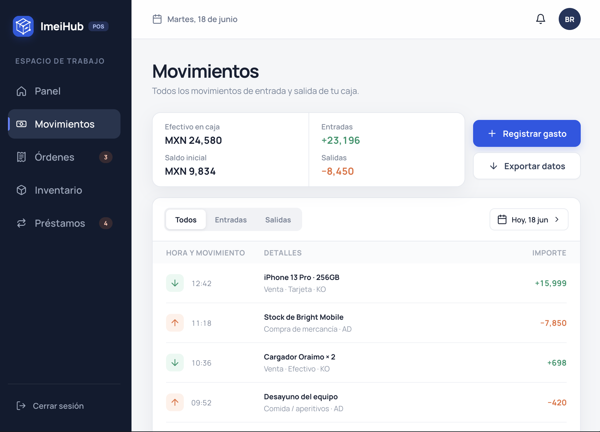
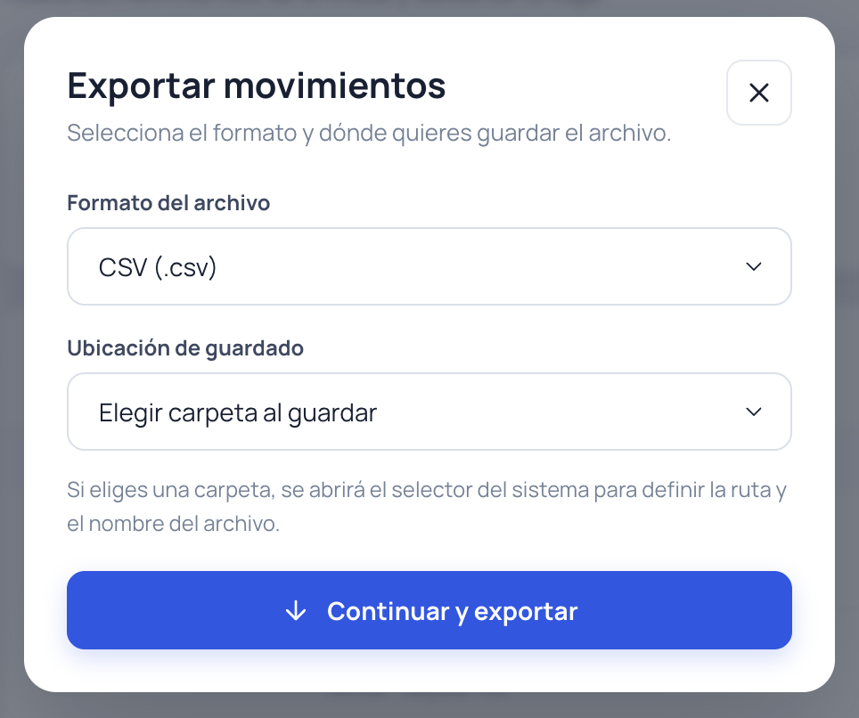
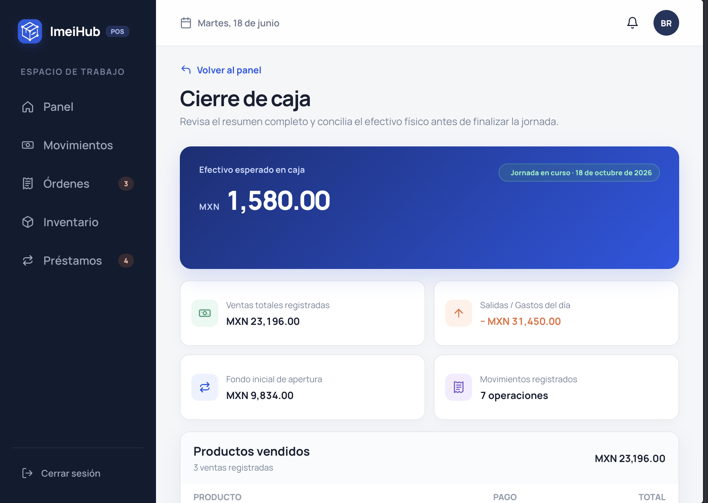
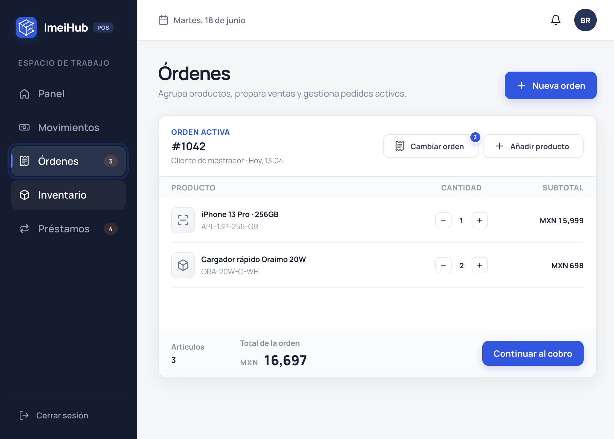
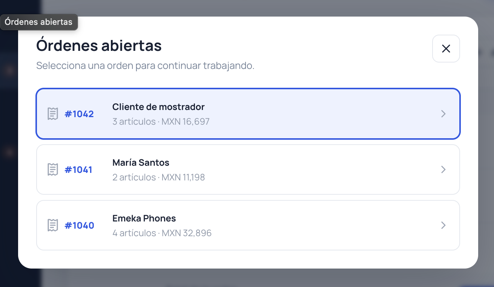
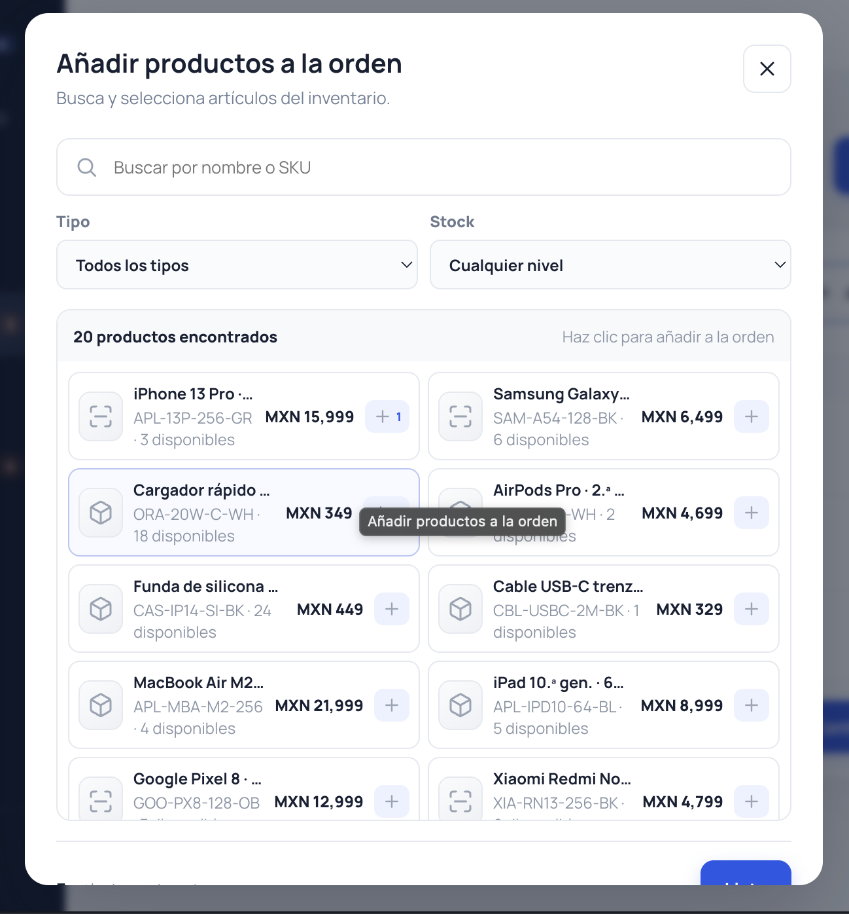
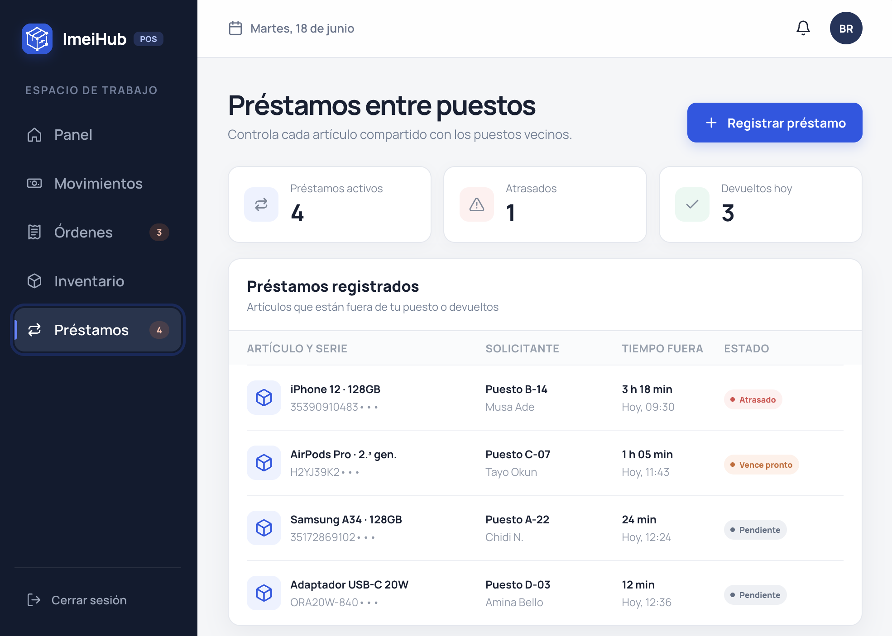

# ImeiHub · Sistema de Punto de Venta y Trazabilidad por IMEI

<p align="center">
  
</p>

<p align="center">
  
  
  
  
</p>

> **ImeiHub** es un sistema integral de punto de venta (POS), control de inventario seriado, trazabilidad por código IMEI, flujo de préstamos entre puestos vecinos y conciliación de caja en tiempo real, concebido para el comercio de telefonía móvil, computación y electrónica en plazas comerciales y puestos de mercado.

---

## 📋 Tabla de Contenidos

1. [¿Qué es ImeiHub y cuál es su funcionalidad?](#-qué-es-imeihub-y-cuál-es-su-funcionalidad)
2. [¿Qué problema resuelve y cómo lo resuelve?](#-qué-problema-resuelve-y-cómo-lo-resuelve)
3. [Explicación detallada de todas las vistas, modales y funcionalidades](#-explicación-detallada-de-todas-las-vistas-modales-y-funcionalidades)
   - [3.1. Acceso y Autenticación (`/login` y `/register`)](#31-módulo-de-autenticación-y-control-de-acceso)
   - [3.2. Panel Principal / Dashboard (`/dashboard`)](#32-vista-de-panel-principal--dashboard-dashboard)
   - [3.3. Inventario y Catálogo Seriado (`/inventory`)](#33-vista-de-inventario-y-catálogo-inventory)
   - [3.4. Movimientos y Flujos de Caja (`/cash`)](#34-vista-de-movimientos-de-caja-cash)
   - [3.5. Cierre de Turno y Arqueo Físico (`/close`)](#35-vista-de-cierre-de-caja-y-arqueo-close)
   - [3.6. Órdenes de Venta y Checkout (`/orders`)](#36-vista-de-órdenes-de-venta-orders)
   - [3.7. Préstamos entre Puestos Vecinos (`/loans`)](#37-vista-de-préstamos-entre-puestos-loans)
   - [3.8. Módulos Flotantes y Overlays Globales](#38-overlays-y-módulos-flotantes-globales)
   - [3.9. Shell, Navegación y Experiencia de Usuario](#39-shell-de-aplicación-navegación-y-notificaciones)
4. [Matriz Resumen de Rutas y Capacidades](#-matriz-resumen-de-rutas-y-capacidades)
5. [Arquitectura Técnica e Integración con API REST](#-arquitectura-técnica-e-integración-con-api-rest)
6. [Backend y Fuente de Datos (Elección y Justificación)](#️-backend-y-fuente-de-datos-elección-y-justificación)
7. [Contrato de API (OpenAPI 3.0.3)](#-contrato-de-api-openapi-303)
8. [Capa de Servicios y Manejo Centralizado de Errores](#-capa-de-servicios-y-manejo-centralizado-de-errores)
9. [CRUD Completo de la Entidad Principal (Productos / Inventario)](#-crud-completo-de-la-entidad-principal-productos--inventario)
10. [Formularios Validados y Estados de Envío](#-formularios-validados-y-estados-de-envío)
11. [Estados de la Interfaz (Carga, Error y Vacío)](#-estados-de-la-interfaz-carga-error-y-vacío)
12. [Trabajo en Equipo y Despliegue Automático (CI/CD)](#-trabajo-en-equipo-y-despliegue-automático-cicd)
13. [Guía de Pruebas con `test.http`](#-guía-de-pruebas-con-testhttp)
14. [Guía de Ejecución Rápida](#-guía-de-ejecución-rápida)

---

## 📱 ¿Qué es ImeiHub y cuál es su funcionalidad?

**ImeiHub** es una Single Page Application (SPA) construida con **Angular 19** y **TypeScript**, optimizada para dispositivos táctiles, computadoras de mostrador y tablets. Está diseñada para digitalizar la operación completa de comercios de telefonía móvil y reparación técnica.

A diferencia de los sistemas de punto de venta convencionales (enfocados en productos de consumo masivo con código de barras universal), el comercio de teléfonos y dispositivos inteligentes requiere:
- **Identificación legal unívoca por equipo:** Control del código IMEI (15 dígitos) o número de serie de cada teléfono individual.
- **Doble precio de venta:** Conocimiento instantáneo del *Precio Ideal* de lista frente al *Precio Mínimo de Negociación* permitido en mostrador.
- **Gestión de préstamos informales:** Control estricto de los equipos que se prestan temporalmente a locales vecinos de la plaza para mostrárselos a clientes ("pasa-manos").
- **Conciliación continua de efectivo:** Registro clasificado de gastos operativos menores ("gastos hormiga") y arqueo físico contra el balance teórico.

---

## 🎯 ¿Qué problema resuelve y cómo lo resuelve?

### 1. Descontrol en la Identificación Unívoca (IMEI vs Código de Barras genérico)
* **El Problema:** Dos cajas de *iPhone 13 Pro 256GB* son artículos idénticos en catálogo, pero legal y técnicamente son dispositivos distintos con historiales, garantías y números de serie únicos. Si un sistema POS los trata como simples códigos de barra repetidos, se entregan IMEIs equivocados a los clientes, perdiendo la garantía con distribuidores y arriesgándose a comercializar equipos con reporte de extravío.
* **Cómo lo resuelve ImeiHub:** Cada artículo en inventario registra su **IMEI o serie individual**, código de barras específico, estado físico (*Nuevo, Seminuevo, Reacondicionado*) y desglose por variantes de color con stock exacto.

### 2. Pérdidas Crónicas por Préstamos Informales ("Pasa-manos" en plazas de tecnología)
* **El Problema:** En plazas comerciales, cuando un cliente busca un color o modelo agotado en un puesto, el dependiente pide prestado el equipo al local vecino por unos minutos. Con frecuencia, si el cliente no compra, el teléfono se queda olvidado en el otro local, se mezcla con mercancía ajena o se extravía, costando decenas de miles de pesos en pérdidas y fricciones entre comerciantes.
* **Cómo lo resuelve ImeiHub:** Cuenta con un **Módulo de Préstamos entre Puestos** donde se asienta qué artículo salió, a qué número de puesto fue (ej. *Puesto B-14*), quién fue el responsable de llevárselo (*ej. Carlos Mendoza*), hora de salida y cronómetro en tiempo real con alertas visuales por retraso. El retorno se confirma formalmente reingresando la unidad a vitrina.

### 3. Descuadre Permanente de Caja Chica y Gastos Operativos
* **El Problema:** Durante la jornada se pagan comidas, pasajes, envíos y refacciones a proveedores que pasan por los pasillos. Sin un registro ágil e inmediato, al final del día la caja nunca cuadra y el comerciante no sabe si faltó dinero por cobros mal hechos, robo hormiga o gastos no apuntados.
* **Cómo lo resuelve ImeiHub:** Flujo contable reactivo en tiempo real (`CashService`) con registro en 2 toques de cualquier gasto clasificado (*Mercancía, Comida, Transporte, Otros*), cálculo del saldo proyectado tras el gasto y un módulo de **Cierre de Caja** que compara el conteo físico en billetes contra el cálculo del sistema, indicando con precisión si el corte es *Exacto*, *Sobrante* o *Faltante*.

### 4. Rigidez en Precios y Pérdida de Ventas en Mostrador
* **El Problema:** En la venta de tecnología usada o seminueva el regateo es habitual. Si el dependiente no sabe hasta cuánto puede bajar el precio, pierde la venta o tiene que llamar al propietario para pedir autorización.
* **Cómo lo resuelve ImeiHub:** Cada producto muestra de forma transparente el **Precio Ideal** y el **Precio Mínimo de Negociación** autorizado, otorgando autonomía a los vendedores para cerrar tratos rentables sin consultar a terceros.

### 5. Complejidad en Medios de Pago y Facturación
* **El Problema:** Clientes que pagan parte en efectivo, parte en transferencia bancaria (SPEI/BBVA) o con terminal física (Mercado Pago/Clip), sumado a quienes requieren factura con CFDI.
* **Cómo lo resuelve ImeiHub:** Pasarela integrada de checkout con cálculo automático de cambio en efectivo, datos bancarios receptores (CLABE y concepto), captura de folio de voucher con tarjeta, y opción de facturación electrónica con validación estricta de RFC y Razón Social, descontando el inventario automáticamente tras confirmar la compra.

---

## 🖥️ Explicación detallada de todas las vistas, modales y funcionalidades

### 3.1. Módulo de Autenticación y Control de Acceso

#### A. Iniciar Sesión (`LoginComponent` · Ruta: `/login`)
Permite a los usuarios acceder al sistema de forma segura.


*Figura 1: Pantalla de inicio de sesión con validación de credenciales, control de visibilidad y acceso rápido.*

* **Formulario Reactivo con Validación:** Validación sintáctica de correo electrónico y contraseña.
* **Componente de Contraseña (`PasswordFieldComponent`):** Toggle visual de ojo para alternar entre texto claro y caracteres ocultos, con tipografía uniforme para evitar distorsiones en el placeholder.
* **Control de Sesión en Memoria:** Autenticación rápida administrada mediante Signals en `AuthService`, asignando token y datos de usuario sin depender de `localStorage`.
* **Guardia de Navegación (`guestGuard`):** Redirige directamente al Dashboard si ya existe una sesión activa para evitar pantallas redundantes.

#### B. Registro de Tienda y Usuario (`RegisterComponent` · Ruta: `/register`)
Permite registrar un nuevo negocio o puesto comercial.


*Figura 2: Registro de nuevo usuario, asignación de tienda y puesto comercial.*

* **Información Integral:** Captura de Nombre completo del titular, Nombre comercial de la tienda (ej. *SmartFix*), Número de puesto físico (ej. *Puesto A-18*) y Correo corporativo.
* **Validación de Seguridad:** Control de longitud mínima de contraseña y comprobación de coincidencia exacta en la confirmación.
* **Ingreso Automático:** Creación de la cuenta en memoria y redirección directa al Panel de Control con bienvenida personalizada.

---

### 3.2. Vista de Panel Principal / Dashboard (`DashboardComponent` · Ruta: `/dashboard`)
Es la pantalla de inicio y centro de mando tras iniciar sesión.


*Figura 3: Panel de control con balance de caja en vivo, ventas y gastos del día, y acciones rápidas táctiles.*

* **Encabezado Personalizado (`PageHeadingComponent`):** Muestra el nombre del encargado, número de puesto y nombre del negocio registrado.
* **Hero Card de Caja (`CashHeroCardComponent`):** Tarjeta destacada con el saldo total de efectivo disponible en caja física, saldo inicial de apertura, indicador de jornada en curso y acceso directo al cierre de caja.
* **Tarjetas Métricas (`MetricCardComponent`):** Dos tarjetas interactivas que reflejan en tiempo real las **Ventas de Hoy** (entradas en verde con monto acumulado) y los **Gastos de Hoy** (salidas en naranja/rojo).
* **Grilla de Acciones Rápidas (`QuickActionsGridComponent`):** Cuadrícula táctil de 6 botones ilustrados para disparar en un solo toque:
  1. *Nueva Venta (Cobro rápido de mostrador).*
  2. *Registrar Gasto (Salida de caja chica).*
  3. *Escanear IMEI / Código de barras.*
  4. *Prestar Artículo (Salida temporal a vecino).*
  5. *Imprimir Etiqueta Térmica.*
  6. *Ver Órdenes de Venta.*
* **Acceso Directo a Cierre de Turno:** Botón de acción prioritaria para concluir la jornada y conciliar efectivo.

---

### 3.3. Vista de Inventario y Catálogo (`InventoryComponent` · Ruta: `/inventory`)
Administra todas las existencias de dispositivos, accesorios y refacciones.


*Figura 4: Catálogo general de productos con búsqueda predictiva, filtros por categoría y stock seriado.*

* **Barra de Herramientas Predictiva (`InventoryToolbarComponent`):**
  - Input de búsqueda en tiempo real con dropdown de sugerencias coincidentes mientras se escribe.
  - Botón de escaneo rápido con cámara/lector.
  - Chips de filtrado por categoría (*Todos, Teléfonos, Computadoras, Tablets, Cargadores, Fundas, Audio*).
  - Botón indicador con contador de filtros activos.
* **Tabla de Inventario (`InventoryTableComponent`):**
  - Listado con SKU, nombre comercial, categoría, precio formateado y badge de existencias (*En Stock*, *Stock Bajo* en amarillo, *Agotado* en rojo).
  - Paginación interactiva y selección de producto para abrir su ficha completa.
* **Hoja de Filtros Avanzados (`InventoryFiltersSheetComponent`):**
  - Filtro por variante de color (*Grafito, Titanio, Plata, Azul, etc.*).
  - Rango de precios configurable (Precio mínimo y máximo).
  - Estado de stock (*Cualquiera, En stock, Stock bajo, Agotado*).
  - Ordenamiento (*Nombre A–Z, Menor precio primero, Mayor precio primero*).


*Figura 5: Formulario de alta al catálogo con variantes de color, costos, IMEI y margen de negociación.*

* **Alta de Nuevos Productos (`ProductAddViewComponent`):**
  - Formulario exhaustivo: nombre, marca, modelo, tipo de equipo, categoría, estado (*Nuevo, Seminuevo, Reacondicionado*), ubicación física en vitrina.
  - Validación de costo, precio mínimo y precio de venta (impidiendo fijar precios de venta menores al costo).
  - Generador dinámico de variantes de color con stock individual.
  - Asignación de SKU e IMEI/Serie.
* **Modal de Detalle de Producto (`ProductDetailModalComponent`):**
  - Ficha técnica con comparativa de **Precio Ideal vs Precio Mínimo**.
  - Identificador unívoco: IMEI, número de serie y código de barras.
  - Selector de variantes de color con stock específico por color.
  - Acciones directas: *Imprimir etiqueta de precio*, *Editar datos* y *Eliminar del inventario* con confirmación.
* **Hoja de Edición de Producto (`ProductEditSheetComponent`):**
  - Edición en caliente de nombre, SKU, precio ideal, precio mínimo, costo y existencias totales con impacto reactivo inmediato en todo el sistema.

---

### 3.4. Vista de Movimientos de Caja (`CashFlowComponent` · Ruta: `/cash`)
Libro contable y flujo de caja diario para control y auditoría financiera.


*Figura 6: Registro cronológico de ingresos y salidas con selector de fechas y balance acumulado.*

* **Resumen de Caja Superior:** Muestra de forma simultánea el efectivo actual, fondo inicial, total de entradas (+) y total de salidas (−).
* **Segmentador de Flujos:** Botones para filtrar el registro entre *Todos*, solo *Entradas* (cobros de ventas) o solo *Salidas* (gastos y compras).
* **Selector de Fechas (`DatePickerSheetComponent`):** Hoja modal con calendario mensual interactivo para consultar el libro contable de días anteriores, con estado vacío descriptivo si una fecha no registra movimientos.
* **Libro Cronológico de Movimientos:** Fila detallada por cada operación con indicador visual de flujo (flecha verde hacia abajo para entrada, flecha naranja hacia arriba para salida), hora, concepto, responsable e importe.


*Figura 7: Hoja modal para exportar el historial contable a Excel (.xls), CSV, Texto tabulado (.txt) o JSON.*

* **Exportador de Datos (`ExportMovementsModalComponent`):**
  - Permite descargar el registro contable en vivo en 4 formatos: **Excel (.xls)**, **CSV (.csv)**, **Texto tabulado (.txt)** o **JSON (.json)**.
  - Permite elegir guardado mediante *File System Picker* o descarga automática en el navegador.

---

### 3.5. Vista de Cierre de Caja y Arqueo (`CashCloseComponent` · Ruta: `/close`)
Protocolo de seguridad y conciliación obligatoria al concluir el turno.


*Figura 8: Conciliación de caja, conteo de efectivo físico, cálculo de sobrante/faltante y corte firmado.*

* **Hero de Efectivo Esperado:** Cálculo automático del dinero teórico que debe haber en caja (*Saldo Inicial + Ventas − Gastos*).
* **Tarjetas de Cuadre:** Resumen de ventas totales del turno, gastos totales, fondo de apertura y total de transacciones.
* **Desglose de Productos Vendidos:** Lista con hora, producto, cantidad, método de pago y monto de cada venta del turno.
* **Calculadora de Arqueo Físico:** Campo numérico donde el dependiente introduce el dinero contado físicamente en billetes y monedas.
* **Semáforo y Diagnóstico de Conciliación:**
  - **Exacta (verde):** Coincidencia al 100% entre físico y sistema.
  - **Sobrante (azul):** Hay más dinero físico que el calculado (+).
  - **Faltante (rojo):** Falta dinero físico con respecto al registro (−) y explicación diagnóstica.
* **Descarga de Comprobante Oficial:** Genera y descarga un archivo `.json` con el corte firmado (hora, puesto, encargado, apertura, ventas, gastos, arqueo, diferencia y observaciones).
* **Botón de Finalizar Cierre:** Registra formalmente el corte y reinicia el estado de la caja.

---

### 3.6. Vista de Órdenes de Venta (`OrdersComponent` · Ruta: `/orders`)
Gestión de carritos de compra, cotizaciones y pedidos simultáneos.


*Figura 9: Espacio de trabajo activo con pedidos en mostrador y cálculo de importes.*

* **Espacio de Trabajo Activo (`OrderWorkspaceComponent`):** Muestra los productos añadidos a la orden activa, cliente asignado, subtotales por artículo y total de la venta.


*Figura 10: Modal para crear una nueva orden asignando folio y tipo de cliente (Minorista / Mayorista).*

* **Creación de Nueva Orden (`NewOrderSheetComponent`):** Genera una orden vacía con número correlativo automático (ej. *#1043, #1044*) y clasificación de cliente (*Minorista* para mostrador o *Mayorista* para distribución).


*Figura 11: Selector para alternar entre diferentes órdenes y carritos abiertos en simultáneo.*

* **Bandeja de Órdenes Abiertas (`OpenOrdersSheetComponent`):** Permite cambiar entre varias órdenes en atención simultánea, mostrando cantidad de artículos y monto acumulado en cada una.


*Figura 12: Selector de catálogo interactivo para incorporar artículos y accesorios a la orden activa.*

* **Selector de Artículos (`OrderProductPickerSheetComponent`):** Modal conectado al inventario para agregar teléfonos y accesorios a la orden activa.
* **Modificación de Cantidades en Vivo:** Botones (+) y (−) que actualizan el conteo de piezas e importes en tiempo real.


*Figura 13: Pasarela de cobro multicanal con cálculo de cambio, folio bancario y facturación electrónica.*

* **Pasarela de Cobro y Checkout (`OrderCheckoutViewComponent`):**
  - **Cobro en Efectivo:** Entrada de efectivo recibido y cálculo automático del cambio a entregar.
  - **Cobro por Transferencia:** Muestra los datos de la cuenta bancaria del local (Banco BBVA, Beneficiario, CLABE y Concepto) y captura del folio de autorización.
  - **Cobro con Tarjeta:** Datos de la terminal y captura obligatoria de los últimos 4 dígitos y código de autorización del voucher.
  - **Facturación Electrónica Opcional:** Toggle que despliega captura de Razón Social, RFC (con validación de 12 a 13 caracteres) y correo electrónico.
  - **Descuento de Stock en Inventario:** Al confirmar el cobro, el stock de los productos comprados se reduce automáticamente en el catálogo y se registra el ingreso en la caja.

---

### 3.7. Vista de Préstamos entre Puestos (`LoansComponent` · Ruta: `/loans`)
Control estricto de mercancía prestada a comerciantes de la plaza comercial.


*Figura 14: Panel de control de mercancía prestada con tiempo transcurrido y estado de devolución.*

* **Métricas Superiores:** Contadores en tiempo real de *Préstamos Activos*, *Préstamos Atrasados* y *Devueltos Hoy*.
* **Tabla de Préstamos:** Muestra el producto, IMEI o serie, número de puesto receptor, nombre de quien se lo llevó, tiempo transcurrido fuera de vitrina y estado (*Pendiente, Atrasado, Devuelto*).


*Figura 15: Hoja rápida para asentar la salida de un equipo, número de puesto y dependiente responsable.*

* **Ficha de Detalle de Préstamo (`LoanDetailModalComponent`):** Consulta de condiciones físicas de entrega, hora límite acordada y notas adicionales.
* **Conciliación de Devolución (`ConfirmReturnModalComponent`):** Modal de confirmación para validar que el equipo fue devuelto en buen estado, marcándolo como *Devuelto* y reintegrándolo al inventario activo.

---

### 3.8. Overlays y Módulos Flotantes Globales

Disponibles desde cualquier parte de la aplicación a través de `OverlayManagerComponent`:
* **Escáner Interactivo (`ScannerModalComponent`):**
  - Simulación de lector óptico con interruptor de linterna/haz de luz.
  - Búsqueda manual por IMEI, serie o código de barras con soporte para tecla Enter.
  - Chips de prueba rápida con SKUs reales del inventario.
  - Tarjeta de resultado con datos del equipo y botones para cobrarlo en venta o darlo en préstamo inmediatamente.
* **Venta Rápida de Mostrador (`SaleSheetComponent`):**
  - Registro de venta en 10 segundos para clientes con prisa.
  - Buscador de producto, ajuste de cantidad validado contra existencias disponibles, selección de método de pago y registro directo en caja e inventario.


*Figura 16: Hoja modal para registrar gastos clasificados y proyectar el efectivo remanente en caja.*

* **Registro Rápido de Gastos (`ExpenseSheetComponent`):**
  - Registro de salidas de efectivo seleccionando categoría (*Mercancía, Alimentos, Transporte, Otros*), importe, justificación obligatoria y cálculo previo del saldo que quedará en caja.
* **Préstamo Rápido (`LoanSheetComponent`):**
  - Modal abreviado para prestar un equipo en pocos segundos con buscador integrado en catálogo, serie, puesto solicitante y persona responsable.
* **Impresión de Etiquetas Térmicas (`PrintLabelSheetComponent`):**
  - Selector de cualquier artículo del inventario.
  - Previsualización a escala de etiqueta térmica estándar (40 × 30 mm) con datos del local (*IMEIHUB · PUESTO A-18*), nombre del producto, especificaciones, precio en pesos mexicanos, código de barras y SKU.
  - Selector de copias e impresión simulada hacia etiquetadora Bluetooth T8.
* **Menú Rápido Móvil (`QuickActionsSheetComponent`):**
  - Panel desplegable optimizado para pantallas táctiles de smartphones que agrupa todos los accesos rápidos a una mano.

---

### 3.9. Shell de Aplicación, Navegación y Notificaciones

* **Shell Principal (`AppShellComponent`):** Contenedor estructural responsivo que adapta la disposición entre modo escritorio (con barra lateral fija) y modo móvil (con barra inferior fija).
* **Barra Lateral (`SidebarComponent`):** Navegación completa con isotipo de ImeiHub, enlaces a las 5 vistas operativas, botón para abrir escáner y botón para cerrar caja.
* **Barra Superior (`TopbarComponent`):**
  - Indicador de la vista actual y fecha del día en curso.
  - Avatar circular dinámico que calcula y muestra las iniciales del usuario logueado en tiempo real (ej. *AO* para Ada Okafor).
  - Popover de perfil (`ProfilePopoverComponent`) con datos del encargado, puesto comercial y botón de cierre de sesión seguro.
* **Barra de Navegación Inferior (`BottomNavComponent`):** Barra fija inferior para smartphones con accesos a Panel, Caja, Botón central (+) de acciones rápidas, Inventario y Órdenes.
* **Sistema de Notificaciones (`ToastComponent` & `NotificationService`):** Mensajes flotantes animados que confirman inmediatamente el éxito, advertencia o error de cualquier acción efectuada por el usuario.

---

## 📊 Matriz Resumen de Rutas y Capacidades

| Vista / Módulo | Ruta URL | Componente Principal | Capacidades Clave |
| :--- | :--- | :--- | :--- |
| **Iniciar Sesión** | `/login` | `LoginComponent` | Autenticación, validación de correo/password, remember-me, guestGuard. |
| **Crear Cuenta** | `/register` | `RegisterComponent` | Registro de titular, tienda, puesto comercial y confirmación de contraseña. |
| **Panel / Dashboard** | `/dashboard` | `DashboardComponent` | Balance de caja en vivo, ventas y gastos del día, accesos rápidos táctiles. |
| **Inventario** | `/inventory` | `InventoryComponent` | Catálogo seriado, búsqueda predictiva, filtros multidimensionales, alta y edición. |
| **Movimientos de Caja** | `/cash` | `CashFlowComponent` | Libro contable cronológico, entradas/salidas, filtro por fecha y exportación (XLS/CSV/JSON). |
| **Cierre de Caja** | `/close` | `CashCloseComponent` | Arqueo físico ciego, cálculo de diferencia (exacto/sobrante/faltante) y comprobante en JSON. |
| **Órdenes de Venta** | `/orders` | `OrdersComponent` | Carritos múltiples, pedidos minoristas/mayoristas, pasarela de checkout y facturación. |
| **Préstamos** | `/loans` | `LoansComponent` | Control de equipos fuera, tiempo transcurrido, alertas de retraso y devolución verificada. |
| **Escáner** | *(Overlay)* | `ScannerModalComponent` | Lectura óptica de IMEI/serie/código, linterna virtual, venta o préstamo directo. |
| **Venta Rápida** | *(Overlay)* | `SaleSheetComponent` | Venta de mostrador en 10 segundos con descuento automático de inventario. |
| **Registrar Gasto** | *(Overlay)* | `ExpenseSheetComponent` | Registro de egresos clasificados por categoría y cálculo de balance resultante. |
| **Imprimir Etiquetas** | *(Overlay)* | `PrintLabelSheetComponent` | Previsualización e impresión de etiquetas térmicas de 40×30 mm con código de barras. |
| **Préstamo Rápido** | *(Overlay)* | `LoanSheetComponent` | Salida inmediata de equipo a local vecino con registro de responsable y puesto. |

---

## ⚡ Arquitectura Técnica e Integración con API REST

ImeiHub implementa una arquitectura desacoplada, tipada y reactiva en **Angular 19** conectada a un backend REST propio construido sobre **Express**, gestionando el estado con **Angular Signals**, validación reactiva estricta mediante **Angular Reactive Forms** (`FormGroup`, `FormControl`, `Validators`) y manejo de errores centralizado a través de interceptores HTTP.

### Estructura Completa del Proyecto:

```
ImeiHub/
├── server/
│   ├── api-server.mjs           # Servidor REST modular con Express (CORS, JSON, Logger, Latencia)
│   ├── db.mjs                   # Gestor de base de datos JSON con persistencia atómica
│   ├── db.json                  # Almacén de persistencia (usuarios, productos, caja, préstamos, órdenes)
│   └── test.http                # Suite completa de pruebas HTTP (REST Client / IntelliJ)
├── openapi.yaml                 # Contrato formal de API bajo especificación OpenAPI 3.0.3
├── src/
│   ├── environments/
│   │   ├── environment.ts            # Configuración de desarrollo (apiUrl: http://localhost:3000/api)
│   │   └── environment.development.ts # Configuración de producción para despliegues
│   └── app/
│       ├── app.config.ts             # Proveedores globales (Router, HttpClient, Interceptors)
│       ├── app.routes.ts             # Definición de rutas protegidas y públicas
│       ├── core/
│       │   ├── guards/
│       │   │   ├── auth.guard.ts     # Protección de rutas privadas (requiere sesión activa)
│       │   │   └── guest.guard.ts    # Redirección de usuarios autenticados fuera de login/register
│       │   ├── interceptors/
│       │   │   └── error.interceptor.ts   # Captura y normalización global de errores HTTP
│       │   └── services/
│       │       ├── api.service.ts         # Cliente HTTP base tipado
│       │       ├── auth.service.ts        # Autenticación, JWT, registro y perfil de usuario
│       │       ├── inventory.service.ts   # CRUD reactivo y filtrado de productos con Signals
│       │       ├── cash.service.ts        # Libro de caja, balance en vivo, entradas y salidas
│       │       ├── loans.service.ts       # Préstamos de equipos y confirmación de devoluciones
│       │       ├── orders.service.ts      # Carrito, tickets, cotizaciones y checkout
│       │       └── notification.service.ts# Toasts reactivos (success, error, warning, info)
│       ├── features/
│       │   ├── auth/
│       │   │   ├── auth-layout/           # Plantilla base compartida para autenticación
│       │   │   ├── login/                 # Inicio de sesión con Reactive Forms
│       │   │   └── register/              # Registro de negocio y usuario con Reactive Forms
│       │   ├── dashboard/
│       │   │   ├── dashboard/             # Panel principal de control
│       │   │   ├── cash-hero-card/        # Métrica destacada de balance en tiempo real
│       │   │   ├── metric-card/           # Indicadores visuales de ventas y órdenes
│       │   │   └── quick-actions-grid/    # Lanzadores táctiles para acciones rápidas
│       │   ├── inventory/
│       │   │   ├── inventory/             # Vista principal de inventario (Loading, Error, Empty)
│       │   │   ├── inventory-table/       # Tabla interactiva con badges de stock
│       │   │   ├── inventory-toolbar/     # Barra de búsqueda y selector de vistas
│       │   │   ├── inventory-filters-sheet/ # Filtro lateral multicriterio
│       │   │   ├── product-add-view/      # Alta de producto seriado con validaciones nativas
│       │   │   ├── product-edit-sheet/    # Edición de precios, costos y stock
│       │   │   └── product-detail-modal/  # Ficha técnica, IMEI y acción de eliminación
│       │   ├── cash/
│       │   │   ├── cash-flow/             # Historial de entradas, salidas y filtros
│       │   │   ├── cash-close/            # Formulario de arqueo físico y conciliación
│       │   │   ├── date-picker-sheet/     # Selector modal de fechas
│       │   │   └── export-movements-modal/# Exportación de movimientos (CSV, XLS, JSON)
│       │   ├── orders/
│       │   │   ├── orders/                # Vista de órdenes activas y carritos
│       │   │   ├── order-workspace/       # Espacio de trabajo de la orden seleccionada
│       │   │   ├── order-checkout-view/   # Pasarela de cobro, desglose y facturación
│       │   │   ├── new-order-sheet/       # Modal de creación de orden (Minorista / Mayorista)
│       │   │   ├── open-orders-sheet/     # Selector de pedidos en espera
│       │   │   └── order-product-picker-sheet/ # Selector de artículos para agregar
│       │   ├── loans/
│       │   │   ├── loans/                 # Tablero de equipos prestados a otros locales
│       │   │   ├── loan-detail-modal/     # Ficha de préstamo y tiempos de entrega
│       │   │   └── confirm-return-modal/  # Verificación física de serie e IMEI al devolver
│       │   └── overlays/
│       │       ├── overlay-manager/       # Coordinador central de modales y drawers
│       │       ├── sale-sheet/            # Venta express en mostrador
│       │       ├── expense-sheet/         # Registro inmediato de gasto clasificado
│       │       ├── loan-sheet/            # Salida rápida de equipo en préstamo
│       │       ├── print-label-sheet/     # Impresión térmica de etiquetas de 40×30 mm
│       │       ├── quick-actions-sheet/   # Menú táctil flotante de accesos directos
│       │       └── scanner-modal/         # Lector óptico de códigos de barras e IMEI
│       ├── components/
│       │   ├── layout/                    # Shell de la aplicación (topbar, sidebar, nav móvil)
│       │   └── ui/                        # Componentes UI reutilizables (field, button, toast...)
│       └── types/                         # Modelos y contratos de TypeScript
```

---

## 🛠️ Backend y Fuente de Datos (Elección y Justificación)

Para el backend se implementó una **API REST propia construida con Node.js y Express** (`server/api-server.mjs`), respaldada por persistencia en archivo JSON (`server/db.json`) mediante sincronización atómica (`server/db.mjs`).

### Justificación de la Elección:
1. **Adopción del Estándar Express:** Proporciona un enrutamiento declarativo y expresivo (`app.get`, `app.post`, `app.put`, `app.delete`, `app.patch`), simplificando el middleware de parsing con `express.json()` y el manejo de cabeceras CORS mediante el paquete oficial `cors`.
2. **Independencia y Modelado Exacto del Dominio:** Una API propia permite modelar al 100% las entidades específicas del negocio de telefonía seriada y plazas tecnológicas (`Product`, `Variant`, `IdentifierData`, `CashEntry`, `LoanEntry`, `User`), algo inviable con APIs genéricas públicas.
3. **Multi-tenancy y Aislamiento por Usuario (`userId`):** El backend aísla el catálogo, los movimientos y los pedidos de cada comerciante. Al registrarse un usuario nuevo, su inventario comienza completamente limpio e independiente de otras cuentas.
4. **Simulación Realista de Latencia:** Incorpora un retardo configurable (100 ms) para evaluar de forma fidedigna los estados de carga (**Loading**, deshabilitación de botones y spinners de espera) en el frontend.
5. **Portabilidad Inmediata sin Configuración de Bases de Datos Externas:** Funciona al clonar el repositorio sin necesidad de instalar Docker, PostgreSQL ni configurar variables en la nube.
6. **Fácil Evolución a Producción:** Al consumir la URL base mediante `environment.apiUrl`, el backend local puede desplegarse en Cloud Run, Railway o sustituirse por NestJS/Supabase sin requerir cambios en el código de Angular.

---

## 📑 Contrato de API (OpenAPI 3.0.3)

El contrato formal de la API se encuentra documentado en el archivo [`openapi.yaml`](openapi.yaml) conforme al estándar **OpenAPI 3.0.3**. A continuación se resume la especificación de endpoints, modelos y errores:

### Endpoints Principales:

| Módulo | Método | Endpoint | Descripción | Códigos HTTP |
| :--- | :--- | :--- | :--- | :--- |
| **Health** | `GET` | `/api/health` | Verificación de estado del servidor | `200` |
| **Auth** | `POST` | `/api/auth/login` | Autenticación de usuario comercial | `200`, `400`, `401` |
| **Auth** | `POST` | `/api/auth/register` | Registro de nuevo comercio o usuario | `201`, `400`, `409` |
| **Auth** | `GET` | `/api/auth/me` | Obtener perfil del usuario autenticado | `200`, `401` |
| **Productos** | `GET` | `/api/products` | Listar catálogo (filtros: `category`, `search`) | `200`, `500` |
| **Productos** | `GET` | `/api/products/{id}` | Obtener detalle de un producto e IMEI | `200`, `404` |
| **Productos** | `POST` | `/api/products` | Crear nuevo artículo seriado en inventario | `201`, `400`, `422` |
| **Productos** | `PUT` | `/api/products/{id}` | Actualizar información del producto | `200`, `400`, `404`, `422` |
| **Productos** | `DELETE` | `/api/products/{id}` | Eliminar producto del inventario | `200`, `404` |
| **Caja** | `GET` | `/api/cash` | Resumen financiero (entradas, salidas, balance) | `200` |
| **Caja** | `POST` | `/api/cash/entries` | Registrar ingreso o egreso manual | `201`, `400` |
| **Caja** | `POST` | `/api/cash/close` | Arqueo y cierre del turno actual | `200`, `400` |
| **Préstamos** | `GET` | `/api/loans` | Listar préstamos a locales vecinos | `200` |
| **Préstamos** | `POST` | `/api/loans` | Registrar salida de equipo en préstamo | `201`, `400` |
| **Préstamos** | `PATCH`| `/api/loans/{id}/return` | Registrar devolución de equipo prestado | `200`, `404` |
| **Órdenes** | `GET` | `/api/orders` | Listar órdenes abiertas y cobradas | `200` |
| **Órdenes** | `POST` | `/api/orders` | Crear nueva orden de venta | `201` |
| **Órdenes** | `PUT` | `/api/orders/{id}/items` | Actualizar productos y cantidades en orden | `200`, `404` |
| **Órdenes** | `POST` | `/api/orders/{id}/checkout` | Cobrar orden, descontar stock y registrar ingreso | `200`, `400`, `404` |

### Estructura Estándar de Respuesta de Error (`ErrorResponse`):
```json
{
  "statusCode": 400,
  "error": "Bad Request",
  "message": "Descripción legible de la causa del error"
}
```

---

## 🔌 Capa de Servicios y Manejo Centralizado de Errores

1. **Separación Estricta:** Ningún componente realiza llamadas `HttpClient` de forma directa. Toda interacción se encapsula en servicios de dominio (`InventoryService`, `CashService`, `LoansService`, `OrdersService`, `AuthService`), los cuales a su vez delegan en un servicio base `ApiService`.
2. **URL Base desde Variables de Entorno:**
   - Desarrollo: `src/environments/environment.ts` (`apiUrl: 'http://localhost:3000/api'`).
   - Producción: `src/environments/environment.production.ts`.
   - Reemplazo automático configurado en `angular.json` bajo `fileReplacements`.
3. **Manejo Centralizado de Errores (`ErrorInterceptor`):**
   - Registrado en `app.config.ts` mediante `provideHttpClient(withInterceptors([errorInterceptor]))`.
   - Detecta fallos de conectividad (`status === 0`, servidor apagado o sin red), errores semánticos `400`, `401`, `403`, `404`, `409`, `422` y errores no controlados `500`.
   - Traduce los códigos HTTP a mensajes claros en español y los proyecta automáticamente en la UI mediante `NotificationService` con toasts de diferentes tonalidades (`success`, `danger`/`error`, `warning`, `info`).

---

## 🔄 CRUD Completo de la Entidad Principal (Productos / Inventario)

La entidad principal **Productos** cuenta con todas las operaciones CRUD implementadas desde la interfaz y conectadas a la API:

1. **Listar (`Read`):**
   - Vista: `InventoryComponent` (`/inventory`).
   - Consume: `GET /api/products`.
   - Soporta búsqueda reactiva en tiempo real y filtrado por categoría (`phones`, `tablets`, `accessories`, `computers`, `audio`).
2. **Ver Detalle (`Read Detail`):**
   - Vista: `ProductDetailModalComponent`.
   - Consume: `GET /api/products/:id` (con respaldo en el store reactivo de Signals).
   - Muestra desglose por variantes de color con stock específico, precio ideal vs. precio mínimo de mostrador, e historial de identificación (IMEI / serie, código de barras y estado físico).
3. **Crear (`Create`):**
   - Vista: `ProductAddViewComponent` (activado desde el botón *"+ Añadir producto"*).
   - Consume: `POST /api/products`.
   - Formulario completo con validación reactiva nativa (`productForm.invalid`), bloqueo del botón de envío si el formulario está vacío o incompleto, y notificación de éxito.
4. **Editar (`Update`):**
   - Vista: `ProductEditSheetComponent` (activado desde el detalle del producto o la tabla).
   - Consume: `PUT /api/products/:id`.
   - Permite modificar nombre, SKU, precio de venta, precio mínimo autorizado, costo de adquisición y existencias con validación síncrona.
5. **Eliminar con Confirmación (`Delete`):**
   - Vista: `ProductDetailModalComponent` mediante el botón con icono de papelera *"Eliminar del inventario"*.
   - Confirmación: Dispara un diálogo nativo de confirmación (`confirm('¿Estás seguro de eliminar...?')`). Al confirmar, emite `DELETE /api/products/:id`, retira el producto del store reactivo y muestra una notificación toast.

---

## 📝 Formularios Validados y Estados de Envío

Todos los formularios de la aplicación utilizan **Angular Reactive Forms** mediante [`FormGroup`](https://angular.dev/api/forms/FormGroup), [`FormControl`](https://angular.dev/api/forms/FormControl) y las validaciones nativas de [`Validators`](https://angular.dev/api/forms/Validators).

### Principios de Validación Implementados:
- **Bloqueo Preventivo del Botón:** El botón de envío se mantiene en estado `disabled` (`[disabled]="form.invalid || loading()"`) mientras la información requerida no haya sido suministrada o contenga errores.
- **Mensajes de Error por Campo:** Se evalúa el estado del control (`ctrl.touched && ctrl.dirty && ctrl.hasError(...)`) para mostrar mensajes claros debajo de cada campo con error.
- **Validadores a Nivel de Grupo:** Validación cruzada en jerarquías de precios (`price >= minPrice`) y coincidencia de contraseñas (`password === confirmPassword`).
- **Deshabilitación Durante Procesamiento:** Evita envíos duplicados bloqueando los botones y mostrando spinners de carga mientras la petición HTTP está en curso.

### Formularios con Validación Nativa:
1. **Iniciar Sesión (`LoginComponent`):**
   - `loginForm`: `email` (`required`, `email`), `password` (`required`, `minLength(6)`), `rememberMe`.
   - Botón *"Acceder al sistema"* deshabilitado inicialmente hasta que el correo tenga formato válido y la contraseña tenga al menos 6 caracteres.
2. **Crear Cuenta (`RegisterComponent`):**
   - `registerForm`: `name` (`required`, `minLength(3)`), `storeName` (`required`), `email` (`required`, `email`), `phone` (opcional), `password` (`required`, `minLength(8)`), `confirmPassword` (`required`), `acceptTerms` (`requiredTrue`).
   - Validador a nivel de grupo `passwordsMatchValidator`.
   - Medidor de seguridad de contraseña reactivo (Débil, Media, Fuerte).
3. **Alta de Producto (`ProductAddViewComponent`):**
   - `productForm`: `name` (`required`, `minLength(3)`), `cost` (`required`, `min(0.01)`), `minPrice` (`required`, `min(0.01)`), `price` (`required`, `min(0.01)`), `type`, `category`, `condition`, `variants`.
   - Validador cruzado `priceHierarchyValidator` (`price >= minPrice`).
4. **Edición de Producto (`ProductEditSheetComponent`):**
   - `editForm`: `name` (`required`), `sku` (`required`), `price` (`required`, `min(0.01)`), `minPrice` (`required`, `min(0.01)`), `cost` (`required`, `min(0.01)`), `stock` (`required`, `min(0)`).
5. **Crear Nueva Orden (`NewOrderSheetComponent`):**
   - `orderForm`: `name` (opcional), `type` (`required`, Minorista o Mayorista).
6. **Checkout y Cobro (`OrderCheckoutViewComponent`):**
   - `checkoutForm`: Efectivo recibido ≥ total de la orden, folio de autorización en tarjeta, y validación estricta de razón social, RFC y correo fiscal si se solicita factura electrónica.
7. **Registrar Préstamo (`LoanSheetComponent`):**
   - `loanForm`: `item` (`required`), `serial` (`required`, `minLength(4)`), `stall` (`required`), `person` (`required`, `minLength(2)`).
8. **Venta Rápida (`SaleSheetComponent`):**
   - `saleForm`: `quantity` (`required`, `min(1)`), `paymentMethod` (`required`), con bloqueo de botones cuando se alcanza el stock máximo disponible.
9. **Registrar Gasto (`ExpenseSheetComponent`):**
   - `expenseForm`: `category` (`required`), `amount` (`required`, `min(0.01)`), `note` (`required`, `minLength(3)`), bloqueando el envío si el gasto supera el efectivo disponible en caja.
10. **Cierre de Caja (`CashCloseComponent`):**
    - `closeForm`: `countedCash` (`required`, `min(0)`), `notes`.

---

## ⏳ Estados de la Interfaz (Carga, Error y Vacío)

Toda vista que consume datos de la API contempla los tres estados esenciales de experiencia de usuario:

1. **Estado de Carga (`Loading`):**
   - Mientras los servicios recuperan datos iniciales de la API, se muestra un contenedor centralizado con spinner CSS animado y el mensaje descriptivo correspondiente (ej. *"Cargando catálogo de productos desde la API..."* o *"Cargando movimientos de caja..."*).
2. **Estado de Error (`Error` con Reintento):**
   - Si el servidor está apagado o responde con error (`status 0` o `500`), la interfaz oculta la tabla y despliega una tarjeta de error estilizada con icono de advertencia, descripción del problema y un botón prominente **"Reintentar conexión"** que vuelve a disparar la petición HTTP sin necesidad de refrescar la página.
3. **Estado Vacío (`Empty State`):**
   - Cuando no existen registros o una búsqueda/filtro no arroja resultados, se presenta una ilustración con mensaje claro (ej. *"No se encontraron productos coincidentes con tu búsqueda"*) y un botón de acción como **"Restablecer filtros"** o **"Añadir nuevo producto"**.

---

## 👥 Trabajo en Equipo y Despliegue Automático (CI/CD)

### Flujo de Trabajo Git Basado en Ramas y Pull Requests:
Para asegurar la calidad del código y la colaboración estructurada:
1. **Rama Protegida `main`:** Ningún integrante del equipo hace push directo a `main`. Todo código nuevo entra exclusivamente mediante **Pull Requests (PR)**.
2. **Nomenclatura de Ramas:**
   - `feature/api-server-rest`: Implementación del servidor Express y contrato OpenAPI.
   - `feature/core-services-crud`: Capa de servicios `HttpClient`, interceptor y Signals.
   - `feature/ui-states-validation`: Integración de spinners de carga, empty states y validaciones.
   - `fix/error-handling`: Correcciones y robustecimiento de respuestas de red.
3. **Checklist Obligatorio para Revisión de PRs:**
   - [ ] Compilación limpia con `npm run build` sin errores de tipos TypeScript.
   - [ ] Verificación de formularios con campos vacíos e inválidos (`FormGroup.invalid`).
   - [ ] Prueba del botón de reintento en caso de error de red.
   - [ ] Al menos una aprobación (`Review Approved`) de otro compañero antes del merge.

### Pipeline de Despliegue Automático (`.github/workflows/ci-deploy.yml`):
Se configuró un flujo de GitHub Actions que:
- Se ejecuta automáticamente en cada **Pull Request** hacia `main`, verificando dependencias, base de datos semilla y compilación de producción (`npm run build`).
- Al realizar **Merge / Push a `main`**, empaqueta los artefactos optimizados de `dist/imeihub-angular/browser` y los despliega automáticamente en **GitHub Pages**.

---

## 🧪 Guía de Pruebas con `test.http`

Se incluye el archivo [`server/test.http`](server/test.http) con la colección completa de peticiones listas para ejecutarse con un clic mediante la extensión **REST Client** de VS Code o el cliente HTTP de WebStorm/IntelliJ:

1. Inicia el servidor backend: `npm run api`.
2. Abre `server/test.http` en el editor.
3. Ejecuta la petición **2.1 Iniciar sesión exitosamente**; la variable `@authToken` capturará el token JWT devuelto.
4. Ejecuta cualquiera de las peticiones para verificar:
   - Casos de éxito (`200 OK`, `201 Created`).
   - Validaciones de negocio (`400 Bad Request`, `422 Unprocessable Entity` cuando el precio de venta es menor al mínimo).
   - Seguridad y credenciales (`401 Unauthorized`, `409 Conflict` en correos duplicados).
   - Rutas no encontradas (`404 Not Found`).

---

## 🚀 Guía de Ejecución Rápida

### 1. Iniciar el Servidor de la API REST:
En una terminal ejecuta:
```bash
npm run api
```
El servidor arrancará en `http://localhost:3000/api` y reportará los endpoints disponibles.

### 2. Iniciar el Frontend de Angular:
En una segunda terminal ejecuta:
```bash
npm start
```
Abre tu navegador en `http://localhost:4200`.

### 3. Ejecutar Ambos con un Solo Comando:
```bash
npm run start:all
```

### 4. Compilar para Producción:
```bash
npm run build
```

---

*Desarrollado con pasión para el comercio tecnológico móvil.*
